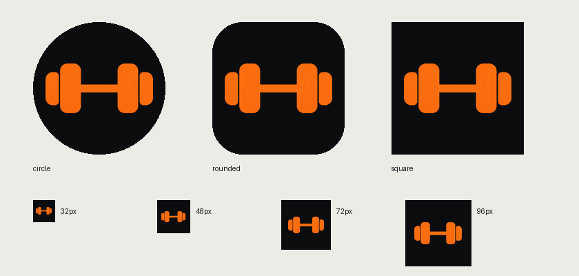

# 新图标与复验记录

用户要求「给软件做一个新图标再测试」。本次仅修改品牌资源、Android / Web 图标声明与显示名称，不改训练逻辑、数据结构和备份格式。

## 图标

使用内置 image_gen 制作图标，保持已有信号橙与炭黑方向。用户最终明确方向：保留最初的哑铃轮廓，去掉中央对勾，改为一根直杆。杠片与几何两版候选只留档、不入包。透明源图、生成提示和资源清单位于 [品牌资源说明](../../../assets/branding/README.md)。

- Android 五档旧图标 + 自适应前景；API 26 / 33 分别声明自适应 / monochrome 层。
- 前景逐档验证 66dp 安全圆，圆形、圆角方形和方形预览通过。
- 网页 favicon、普通图标、maskable 图标同步。
- Android 桌面名称与网页安装名称统一为「健身记录」。
- 原生成文件留在生成缓存，项目使用的源图已复制到 assets；重新打包不依赖缓存。

## 验证与设备边界

最终验证时间：2026-10-16 12:21（Asia/Shanghai）。本轮未修改 Dart 功能源码；全量功能检查通过后，最后一次图形编辑仅替换 PNG，并重新打包、构建和运行以下浏览器场景。

| 检查 | 实际结果 |
|---|---|
| flutter analyze --no-pub | 无问题 |
| flutter test --no-pub --reporter expanded | 334 条通过 |
| 图标打包 | 17 项资源尺寸 / 模式与清单一致，RGBA 源图透明 |
| 安全裁切 | Android 五档 66dp 安全圆、Web maskable 安全圆通过；圆形 / 圆角 / 方形及小尺寸人工查看通过 |
| Web 发布构建 | 成功；构建目录 favicon / 四张图标与最终源资源字节一致 |
| 训练浏览器 | 7/7，无运行时错误 |
| 备份浏览器 | 6/6，真实文件下载 / 上传、旧格式、空库与重启 |
| 导入浏览器 | 4/4，真实 CSV、取消、重复默认不选、备份往返 |
| 计划 / 删除浏览器 | 8/8，轮转、排序、临时选择、移除两分支、重启与整场删除 |
| Android debug / release | 均构建成功；逐包比对 10 张 PNG 的尺寸、透明度与可见像素，全部匹配最终资源 |
| 编译后资源声明 | 两包均含 API 26 自适应和 API 33 monochrome 层，包名 / 显示名称正确 |
| Android 真机 | ADB 无设备，未安装或操作手机应用 |

日志为 `build/icon-analyze.log`、`build/icon-tests.log`、`build/icon-web.log`、`build/icon-debug.log`、`build/icon-release.log` 与 `build/icon-browser-*.log`。最终结果及包内资源 / XML 取证位于 `build/acceptance/icon-2026-10-16/verification.json` 及同目录；构建证据不纳入版本控制。

最终浏览器证据（目录时间为 UTC）：

- `build/acceptance/browser-2026-10-16T04-19-41-468Z/`
- `build/acceptance/browser-backup-2026-10-16T04-19-41-513Z/`
- `build/acceptance/browser-import-2026-10-16T04-20-22-499Z/`
- `build/acceptance/browser-plans-2026-10-16T04-20-13-787Z/`

## 当前安装包

- 发布包：`build/app/outputs/flutter-apk/app-release.apk`，69,437,977 字节。
- SHA-256：`51EF7623C760D2D9BAE6ED04AE9F91B632AD2081EB0297E2FEE370629668514A`。
- debug 包：`build/app/outputs/flutter-apk/app-debug.apk`，208,621,330 字节；SHA-256 `5B24B7F72BDB768F43A278E6C10C55364653578C9A9FCC5DA2B646226DC97332`。
- 两包包名均为 `com.mobis.gym_tracker`，versionCode 1，versionName 1.0.0，compileSdk 36；显示名称「健身记录」。
- 最终透明源图 SHA-256：`681B3AD43F10C0AF9461F7136E34D8D727BCA3B9CE7682566A9A237EC119FD99`。

## 接续

本轮 ADB 检查均未发现设备；连接并允许 USB 调试后才能继续 Android 原生桌面 / 主题图标显示、系统文件选择与 Phase 3A / 3B / 4 真机矩阵。不能用构建成功或浏览器结果代替真机通过。使用独立 `.acceptance` 包完成有数据替换 / 删除的场景；不清空主应用训练。

本轮没有新增 Flutter 依赖，schema v4 / backup v2 保持。用户已有 `.claude/settings.local.json` 与 `.tmp/` 排除提交，未推送远程。
